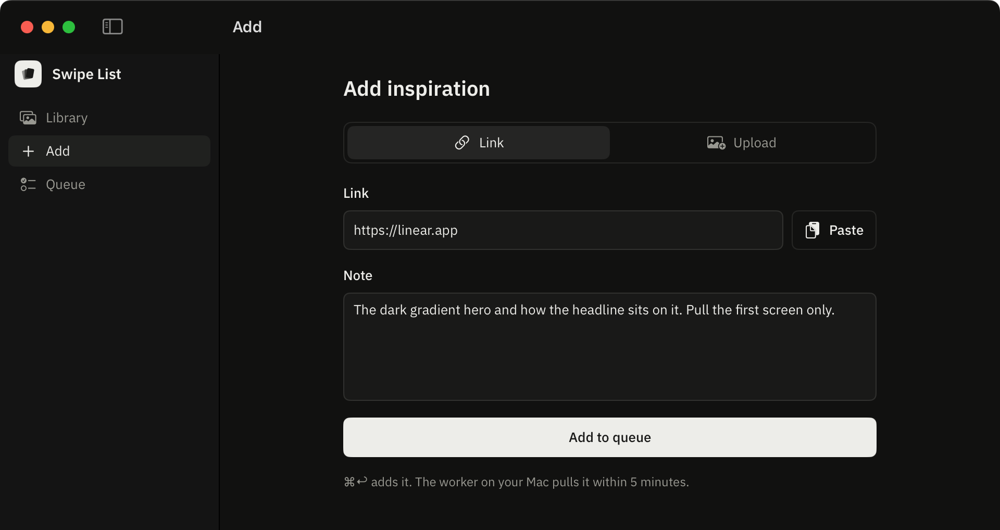

# Swipe List

<p align="center">
  <a href="LICENSE"></a>
  
  
  
  
  
</p>

<p align="center">
  
  
  <a href="https://zazencodes.com/"></a>
</p>

> **Part of [zstack](https://github.com/zazencodes/zstack)**, the agentic system I use to run ZazenCodes.

A searchable library of design inspiration that your agents can use.

Save a link or a screenshot from your phone, your Mac or the terminal, with a note
on what you like about it. A worker on your Mac has Codex collect the media (the
images, the video, screenshots of the page), describe it and tag it. When your
agent designs a thumbnail, a page or a video, it searches your library first and
tells you which saved references it drew on.

## What's in it

- **Server:** a Node and TypeScript (Hono) API with two listeners: a public one
  for agents and apps, which accepts only credentials, and a private one for the
  dashboard. Records, files and sign-in live in one [Neon](https://neon.com)
  project.
- **Phone dashboard:** add it to your home screen. Add a link with a note or
  upload screenshots, browse and search the library, watch the queue, retry
  failures and delete items. `/add?url=<link>&note=<text>` opens the add form
  filled in, for share-sheet shortcuts. It is reachable only on your tailnet
  (Tailscale), and only your email can sign in.
- **Worker:** runs on your Mac every 5 minutes (through
  [Koyomi](https://github.com/zazencodes/koyomi)). X posts go through a small
  script that reads the public fxtwitter API; everything else goes through your
  own logged-in Chrome, driven by Codex. Codex decides what to pull and writes
  the description and tags; the worker script does the uploads and bookkeeping.
- **`swipe` CLI and the `inspo-swipe-list` skill:** for you and your agents:
  `swipe add`, `swipe upload`, `swipe search`, `swipe show`, `swipe download`.
  Your server serves both, so they always match it.
- **Mac app:** a native SwiftUI client for macOS 15 and later, in `macos/`.
  Browse and filter, play videos, add links and images, manage the queue.

## Get your own

Follow [docs/self-hosting.md](docs/self-hosting.md). You need a Neon account
(the Free plan is enough to start), a small Linux server, a domain, Tailscale,
and for the worker a Mac with Codex, Chrome and FFmpeg.

**Security:** the worker runs Codex with full access to its macOS user and that
user's logged-in Chrome, so a malicious page could try to steer it. Run it under
a separate macOS user with its own Chrome profile. See
[the accepted-risk ADR](docs/adr/2026-10-26-worker-runs-with-the-owners-privileges.md).

If you use [zstack](https://github.com/zazencodes/zstack), ask your agent to add
Swipe List; it follows the same guide.

## Using it

- **Phone:** with Tailscale on, open the dashboard, add a link with a note on
  what to pull and what you like, or upload screenshots. Items show in Queue
  until the worker has pulled them, then in Library.
- **Mac:** in the Mac app, choose **Use Swipe CLI connection** on first launch
  if `swipe` is signed in, or paste your server's URL and a credential. The app
  keeps the credential in your login Keychain.
- **Agents:** with the skill installed, ask your agent to use your swipe list
  when it designs something, or to add a link to it.



## Documentation

- [docs/self-hosting.md](docs/self-hosting.md): set up, check, update and remove.
- [docs/data-model.md](docs/data-model.md): tables, bucket layout, the queue and search.
- [docs/adr/](docs/adr/): why it is built this way and what was rejected.
- [src/worker/instructions.md](src/worker/instructions.md): what Codex does with each item.
- [skill/inspo-swipe-list/SKILL.md](skill/inspo-swipe-list/SKILL.md): how agents use it.

## Development

Needs Node.js 24 or newer (npm 11).

```sh
npm install
npx neon link                                   # your Neon project
npx neon branches create --name dev && npx neon branches create --name test
npx neon env pull --branch dev --file .env.local   # then append the app variables from .env.example
printf 'TEST_DATABASE_URL=%s\n' "$(npx neon connection-string test)" > .env.test
npm run dev          # dashboard listener :9021, agent listener :9022 (migrations run at boot)
npm run dev:web      # dashboard on http://localhost:5173, proxying /api
npm test             # integration tests; each run wipes the test branch's public schema
npm run typecheck && npm run typecheck:web
npm run swipe -- --help                          # CLI from source
npm run admin -- credentials create <name>       # against the dev branch
cd macos && swift test                           # Mac app unit tests
```

## Layout

```
src/server/        Hono API, auth, storage, migrations runner, admin script
src/server/domain/ items, search and the queue
src/client/        API client shared by the CLI and the worker
src/cli/           swipe CLI (bundled to dist/swipe.mjs, served at /downloads/swipe.mjs)
src/worker/        ingestion worker, Codex instructions, answer schema, tools/x-post.mjs
web/               React dashboard (built to dist/web)
macos/             native Mac app (SwiftUI)
skill/             inspo-swipe-list agent skill (served at /downloads/inspo-swipe-list.tar.gz)
migrations/        SQL schema
docs/              self-hosting guide, data model and ADRs
deploy/, scripts/  systemd unit, Caddy site, build, deploy script, client installer
```

## Changelog

See [CHANGELOG.md](CHANGELOG.md). Releases are tagged `vX.Y.Z`.

## License

[GPLv3](LICENSE). You can use, modify and share this code, and any version you distribute must also be released under GPLv3.
The Mac app bundles IBM Plex Sans and Mono under the SIL Open Font License (`macos/Resources/Fonts/OFL.txt`).

<p align="center">
  <a href="https://zazencodes.com/?utm_source=github&utm_medium=referral&utm_campaign=swipe-list">
    
  </a>
  <br>
  Created by <a href="https://zazencodes.com/">ZazenCodes</a>
</p>
